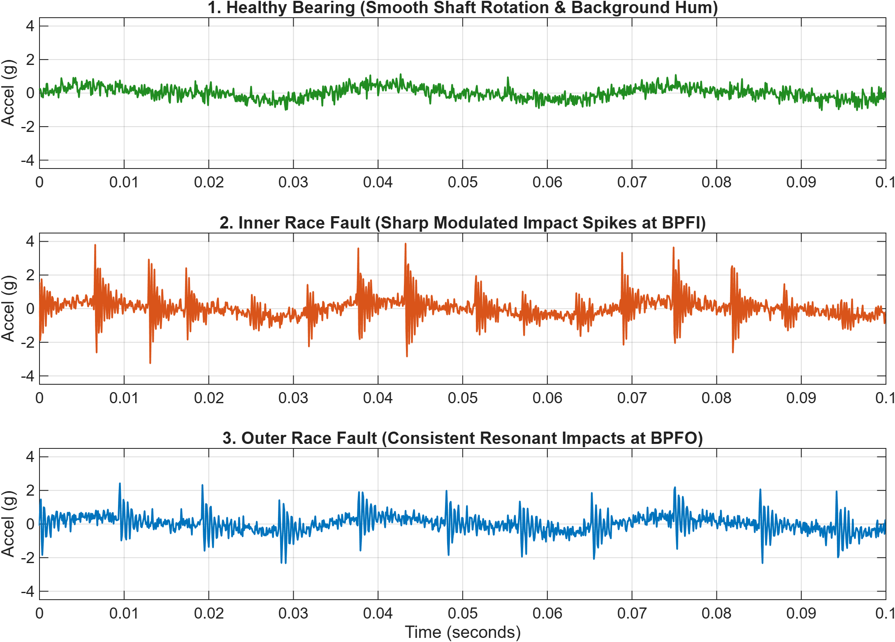
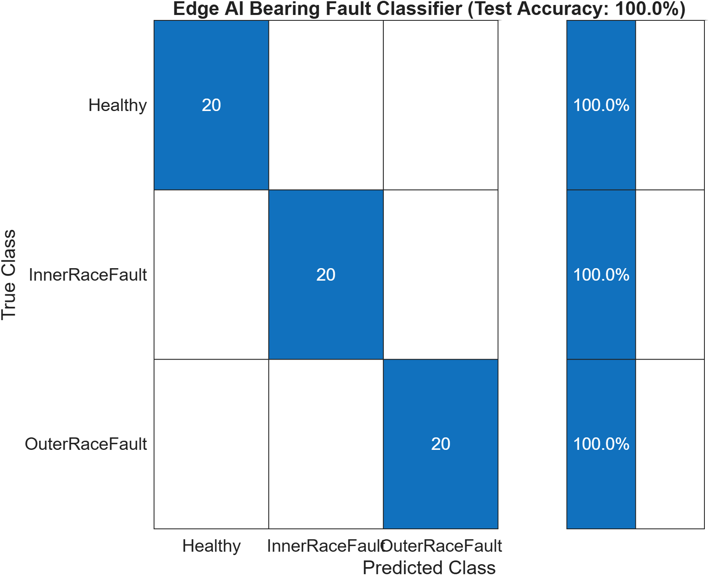
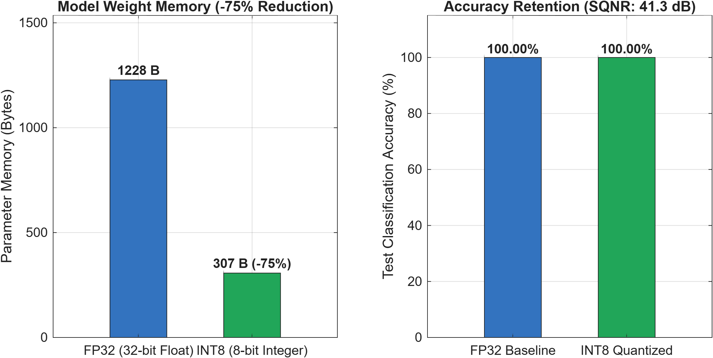

# EdgeAI-Bearing-Fault-Monitor

An end-to-end **Predictive Maintenance & TinyML pipeline** built in MATLAB that diagnoses industrial motor bearing faults from vibration signals, compresses the neural network via **Post-Training INT8 Quantization** to a **307-Byte** footprint, and exports **zero-dependency ANSI C** inference code ready for microcontrollers (ESP32, STM32, ARM Cortex-M).

---

## Key Results & Compression Benchmarks

| Metric | FP32 Baseline | INT8 Quantized (Edge) | Impact |
| :--- | :---: | :---: | :---: |
| **Total Parameters** | 307 | 307 | Ultra-compact `8 -> 16 -> 8 -> 3` MLP |
| **Weight Memory Footprint** | 1,228 Bytes (1.20 KB) | **307 Bytes (0.30 KB)** | **-75.0% memory reduction** |
| **Test Classification Accuracy** | 100.00% | **100.00%** | **0.00% accuracy degradation** |
| **Signal-to-Quantization-Noise Ratio** | Reference | **41.27 dB** | High numerical fidelity |
| **Target Runtime Dependencies** | MATLAB / DL Toolbox | **Standard `<stdint.h>` C99** | Zero external runtime libraries |

---

## System Pipeline

1. **Physics-Based Vibration Synthesis (`step1_load_and_visualize.m`)** — Generates 300 labeled 12 kHz vibration recordings across Healthy, Inner Race Fault (`BPFI`), and Outer Race Fault (`BPFO`) states.
2. **Lightweight Edge Feature Extraction & Training (`step2_train_edge_model.m`)** — Compresses 3,000 raw samples into 8 diagnostic time/frequency features and trains an `8 -> 16 -> 8 -> 3` neural network.
3. **Post-Training INT8 Quantization (`step3_quantize_edge_model.m`)** — Applies symmetric `INT8` weight quantization (`[-127, 127]`) and activation calibration, achieving **41.27 dB SQNR** with zero accuracy loss.
4. **Standalone Embedded C Code Generation (`step4_export_embedded_c.m`)** — Exports `edge_bearing_inference.h`, `edge_bearing_inference.c`, and `test_inference_main.c` using pure `int8_t`/`int32_t` integer math.

---

## Visual Outputs

### 1. Bearing Vibration Signatures

### 2. Test Set Confusion Matrix (100.0% Accuracy)

### 3. FP32 vs. INT8 Memory & Accuracy Benchmark

---

## Author
**Muhammed Akthus C N**  
B.Tech in Electronics and Communication Engineering  
Chair, IEEE Signal Processing Society SBC | Treasurer, IEEE Student Branch — Toc H Institute of Science and Technology
